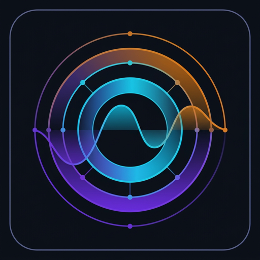

<p align="center">
  
</p>

<h1 align="center">Auralis (<code>v0.2.0</code>)</h1>

<p align="center">
  Headless Audio Graph Compiler &amp; Auditory Telemetry Engine in pure Rust for autonomous AI agents.
</p>

## For AI Agents
See [AGENTS.md](AGENTS.md) for crate layout, exact commands, architectural boundaries, and git workflow, [DESIGN.md](DESIGN.md) for invariants, [skills/](skills/) for anti-generic composition & sound-design skills, and [doc/adr/](doc/adr/) for Architecture Decision Records (`ADR-0001` through `ADR-0017`).

## Capabilities (`v0.2.0`)
- **Declarative Composition**: JSON/YAML `Song` manifests with reusable `Pattern` definitions, track `Clip` scheduling (`repeat`, `transpose_semitones`, `velocity_scale`), chords, portamento (`slide_to_midi`), and seamless `LoopPoints`.
- **Pre-Render Intelligence & Skills**: Static `<1 ms` manifest linting (`auralis lint` / `auralis_lint_manifest`) catching flat velocities, bare oscillators, missing `Pattern`/`Clip` reuse, and low-end masking before synthesis, paired with archetype scaffolding (`init --archetype`) and 4 embedded composition/SFX skills.
- **Three Synthesis Backends**:
  - `Synth`: Multi-waveform oscillators, ADSR & pitch envelopes, unison detune with constant-power stereo spread, vibrato LFO, 2-op FM synthesis, per-note `FilterEnvelope`, and percussion/noise synthesis.
  - `SoundFont`: Cached SF2 rendering via `rustysynth` with block-based MIDI pitch bend and CC64 damper sustain.
  - `Sample`: Cached external WAV one-shot and pitched/glide playback (`InstrumentConfig::Sample { wav_path, root_midi }`) with graceful missing-file fallback.
- **Deterministic Parallel DSP & FX**: Multi-threaded track rendering (`std::thread::scope`), resonant `LowPass` / `HighPass` / `BandPass` biquad filters, beat-synced `FilterSweep`, `Saturate`, `SoftClip`, `Compressor`, track-keyed `Sidechain` ducking, `StereoWidth`, tempo-synced ping-pong `Delay`, Schroeder stereo `Reverb`, and `master_fx`.
- **Game & DAW Export**: 32-bit/16-bit WAV with RIFF `smpl` loop chunks, OGG Vorbis with `LOOPSTART`/`LOOPLENGTH` tags (via `ffmpeg`), and equal-length `--stems` export.
- **Closed-Loop Auditory Telemetry**: Peak/RMS dBFS, crest factor, stereo correlation, side-to-mid ratio, 32-window Hann FFT spectral energy ratios, time-sliced `sections`, and automated mix `diagnostics`.
- **MCP Server**: Built-in stdio server exposing `auralis_init_manifest`, `auralis_lint_manifest`, `auralis_compile_audio`, `auralis_inspect_soundfont`, `auralis_eval_wav`, plus `prompts` and `resources` serving all 4 `skills/`.

## Quick Start
```bash
cargo build --release
cargo run -- init demo.json --archetype synthwave
cargo run -- lint demo.json --strict
cargo run -- compile demo.json -o output.wav --stems
cargo run -- compile examples/showcase_synthwave.json -o showcase_synthwave.ogg
cargo run -- eval output.wav
cargo run -- serve
```

## Examples
Explore [examples/](examples/) for multi-genre BGM showcases (`showcase_synthwave.json`, `showcase_lofi_jazzhop.json`, `showcase_edm_future_bass.json`, `showcase_cinematic_ambient.json`, `trap_anthem.json`, `uk_drill_dark.json`) and procedural SFX (`sfx_door_close.json`, `sfx_lightning_thunder.json`, `sfx_laser_shoot.json`).
